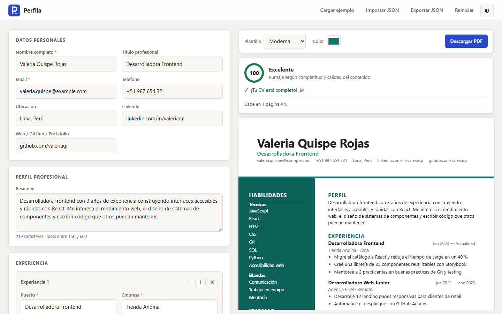

# Perfila

*Generador de CV · tu currículum listo para ATS*

<br clear="left" />

**Escribe tu currículum una vez, míralo en vivo con cuatro diseños y descárgalo como un PDF con texto real, legible por los sistemas ATS.** Sin cuentas, sin servidor y sin dependencias: todo ocurre en tu navegador.

**🔗 [Ver demo en vivo](https://cv-generator-beryl-two.vercel.app/)** · [Notas de la versión 1.0.0](https://github.com/Itsfavi0/cv-generator/releases/tag/v1.0.0)



## Funcionalidades

- **Vista previa en vivo**: cada tecla actualiza el CV al instante.
- **4 plantillas**: Clásica (serif, centrada), Moderna (barra lateral de color), Minimalista (versalitas y mucho aire) y Ejecutiva (encabezado oscuro, dos columnas), con **color de acento** a elección.
- **Puntaje de calidad (0–100)** con consejos concretos para mejorarlo (se muestran los 3 primeros pendientes): resumen de 150–600 caracteres, al menos 2 logros por experiencia, viñetas de 200 caracteres como máximo, logros cuantificados, al menos 5 habilidades técnicas, etc.
- **Validación amable**: los errores aparecen al salir del campo, no mientras escribes. Nombre y email obligatorios; teléfono, LinkedIn, web y fechas se comprueban.
- **Aviso de longitud**: cuenta las páginas A4 que ocupará el PDF y avisa si pasa de 2, el máximo habitual en procesos de selección.
- **Exportar a PDF** con la impresión nativa del navegador, en A4 y sin márgenes. El texto se puede seleccionar y copiar. `Ctrl+P` también pasa por la validación antes de imprimir.
- **Experiencia, proyectos y educación** con varias entradas que se pueden reordenar (↑ ↓) y eliminar, con opción de **Deshacer**. En experiencia y proyectos, **cada línea de logros es una viñeta** (con o sin guion) y bajo el campo se ve cuántas hay y qué mejorar.
- **Habilidades en dos grupos**, técnicas/herramientas y blandas (opcionales, máx. 6), como etiquetas: Enter para añadir, varias a la vez separadas por comas y sin duplicados entre grupos.
- **Proyectos** como sección opcional (nombre, enlace, tecnologías, fechas y logros), pensada para perfiles junior.
- **LinkedIn** en su propio campo, separado de la web o el portafolio.
- **Certificaciones e idiomas** como secciones opcionales: la certificación lleva entidad emisora, fecha y enlace a la credencial; el idioma se elige de una lista cerrada de niveles con su equivalente MCER ("Intermedio alto (B2)"). Si están vacías no aparecen en el CV ni restan puntaje.
- **Guardado automático** en `localStorage`. **Importa y exporta** tus datos en JSON.
- **Modo claro y oscuro** (sigue al sistema o se elige con ◐) y diseño **responsivo** hasta 375 px.
- Accesible con teclado: foco visible, `aria-invalid` en los errores y se respeta `prefers-reduced-motion`.

## Stack

| Parte | Tecnología |
|---|---|
| Interfaz | HTML semántico, CSS con variables y *container queries* |
| Lógica | JavaScript puro con módulos ES, **sin frameworks ni bundler** |
| PDF | `window.print()` + `@media print` + `@page { size: A4; margin: 0 }` |
| Persistencia | `localStorage` (con `try/catch`) |
| Tests | `node:test` y `node:assert`, sin dependencias |
| Servidor de desarrollo | `node:http` (≈40 líneas) |

## Instalación y uso

Requisitos: Node.js 20 o superior. No hay que instalar paquetes.

```bash
git clone https://github.com/Itsfavi0/cv-generator.git
cd cv-generator
npm start
```

Abre <http://localhost:5173>. Pulsa **Cargar ejemplo** para ver un CV completo, cambia de plantilla y pulsa **Descargar PDF** (en el diálogo, elige "Guardar como PDF").

> Los módulos ES no funcionan abriendo `index.html` con doble clic (`file://`); por eso se incluye un servidor estático mínimo. También sirve cualquier otro, como la extensión Live Server.

## Despliegue

Es un sitio 100 % estático y todas las rutas son relativas, así que funciona en cualquier hosting de archivos y también dentro de una subcarpeta. Solo hacen falta `index.html`, `favicon.svg` y `src/`; `tests/`, `scripts/` y `package.json` son para desarrollo.

La demo está publicada en **[Vercel](https://cv-generator-beryl-two.vercel.app/)**. No necesita comando de build: el directorio de salida es la raíz del repositorio.

También funciona sin cambios en GitHub Pages (*Settings → Pages → Deploy from a branch*, rama `main`, carpeta `/ (root)`), Netlify o Cloudflare Pages.

## Tests

```bash
npm test
```

Hay 51 pruebas sobre la lógica pura: formato de fechas y URLs, validación, puntaje, conteo de páginas, saneamiento de datos importados y almacenamiento (con un `localStorage` simulado y otro que lanza errores). La interfaz se verificó a mano en el navegador (Chrome y Safari de iPhone), incluidos el ancho de 375 px y la impresión de las 4 plantillas en A4.

## Estructura

```
cv-generator/
├── index.html             # Formulario, barra de vista previa y plantillas <template>
├── favicon.svg            # Logo de Perfila (también va en línea en la barra superior)
├── src/
│   ├── js/
│   │   ├── app.js         # Estado, eventos, toasts, importar/exportar, tema e impresión
│   │   ├── model.js       # Forma de los datos, normalizeCV (saneamiento), ejemplo
│   │   ├── validation.js  # validateCV → { "ruta.del.campo": "mensaje" }
│   │   ├── score.js       # Criterios del puntaje y consejos
│   │   ├── storage.js     # loadCV / saveCV / clearCV con storage inyectable
│   │   ├── render.js      # Genera el HTML del CV (igual para todas las plantillas)
│   │   └── utils/         # el() para crear nodos, debounce y funciones de formato
│   └── styles/
│       ├── app.css        # Editor: tokens, modo oscuro, layout, impresión
│       └── cv.css         # Hoja A4 y las plantillas
├── tests/                 # *.test.js con node:test
├── scripts/serve.js       # Servidor estático de desarrollo
└── docs/screenshot.png
```

## Decisiones técnicas

- **JavaScript puro en vez de React.** El objetivo del proyecto es dominar el DOM, los eventos y el estado sin abstracciones. El estado es un único objeto `cv`; cada cambio llama a `update()`, que valida, recalcula el puntaje, programa el render y guarda.
- **PDF con la impresión del navegador en vez de jsPDF o html2canvas.** Esas librerías suelen convertir el CV en una imagen: los sistemas ATS no pueden leerla y el texto no se puede copiar. Con `@media print` el PDF tiene texto real y no hace falta ninguna dependencia.
- **Un solo HTML para todas las plantillas.** `render.js` genera siempre la misma estructura semántica (`header`, `section`, `article`) y cada plantilla es solo CSS (`.cv--modern`, etc.). Añadir un diseño no toca JavaScript. En la Moderna, las habilidades aparecen a la izquierda con `order: -1`, pero en el HTML van después de la experiencia, que es el orden que leen los ATS.
- **Seguridad sin `innerHTML`.** Todo el contenido del usuario se inserta como nodos de texto con el helper `el()`, así que escribir `` en el nombre se muestra literalmente. Los enlaces solo aceptan `http`/`https` (`toHref`), y los datos importados o guardados pasan por `normalizeCV`, que descarta campos desconocidos, tipos incorrectos y textos demasiado largos.
- **Errores solo en campos "tocados".** Mostrar "El email es obligatorio" antes de que el usuario escriba nada resulta agresivo. Los errores aparecen al salir del campo (`focusout`) o al intentar descargar el PDF.
- **`localStorage` inyectable.** `storage.js` recibe el almacenamiento como parámetro, así que se prueba en Node sin navegador. Todas las llamadas van en `try/catch` porque en modo privado o con las cookies bloqueadas `localStorage` lanza errores.
- **Render agrupado con `requestAnimationFrame` y guardado con `debounce`.** Escribir rápido no re-renderiza ni guarda en cada tecla.
- **Alto mínimo A4 con un pseudo-elemento.** Con `aspect-ratio` sobre el contenedor flex, Chrome dejaba la hoja con alto fijo y en móvil el texto se salía. Un `::before` invisible con `padding-top: calc(100% * 297 / 210)` fija el mínimo y la hoja crece si el CV es largo.
- **Las plantillas se adaptan al ancho de la hoja, no al de la ventana** (`container-type: inline-size`). En móvil, la barra lateral de la Moderna pasa debajo; al imprimir siempre se ve el diseño A4 completo.
- **Habilidades técnicas y blandas separadas, pero no iguales.** Los ATS filtran sobre todo por palabras clave técnicas, y un reclutador cree más una habilidad blanda cuando la ve demostrada en un logro que en una lista. Por eso las blandas son opcionales y como máximo 6, y el puntaje solo cuenta las técnicas. En el CV van en una sola sección "Habilidades" con subtítulos en texto, que un ATS lee como cualquier otra línea. Los datos de la v1.0.0 (un solo array) se migran solos a "técnicas".
- **Logros siempre en viñetas, con avisos que no bloquean.** Las viñetas son el formato estándar de la experiencia, así que cada línea se convierte en una sin exigir el guion. Las reglas de estilo (al menos 2 logros, máximo 200 caracteres por viñeta) aparecen bajo el campo y en el puntaje, pero nunca impiden descargar el PDF: solo los datos incorrectos (un email inválido) lo hacen. El resumen del perfil sigue siendo un párrafo.
- **Contar páginas con una copia invisible del CV.** La vista previa cambia de diseño en pantallas estrechas, así que medirla daría otro número. Se renderiza una copia oculta a 210 mm de ancho y se divide su alto por el de una hoja A4. Al imprimir, una entrada larga se puede partir entre páginas (sin separar su encabezado de la primera viñeta) y el relleno de la plantilla se repite en cada página con `box-decoration-break: clone`, para que la página 2 no empiece pegada al borde.
- **Idiomas en una sola línea de texto.** "Inglés: Intermedio alto (B2)" se escribe como un único texto sin mezclar negrita y normal: al extraer el texto del PDF, los estilos distintos se separaban y el nivel quedaba lejos del idioma. El nivel incluye el código MCER para que coincida tanto con "Intermedio" como con "B2" en un filtro.
- **Límites razonables** (120 caracteres por campo corto, 2000 en descripciones, 20 entradas por sección, 30 habilidades, JSON de 1 MB como máximo) para que un archivo importado no bloquee la página.

## Ideas futuras

- Botón "Ver vista previa" fijo en móvil, porque ahora la hoja queda debajo de todo el formulario.
- Elegir la tipografía de cada plantilla.
- Reordenar las entradas arrastrándolas, además de con los botones ↑ ↓.
- Tests de interfaz con Playwright.

## Licencia

[MIT](LICENSE) © 2026 Favio Brañez
